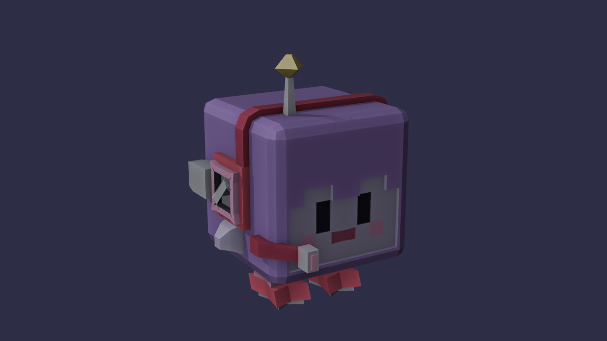
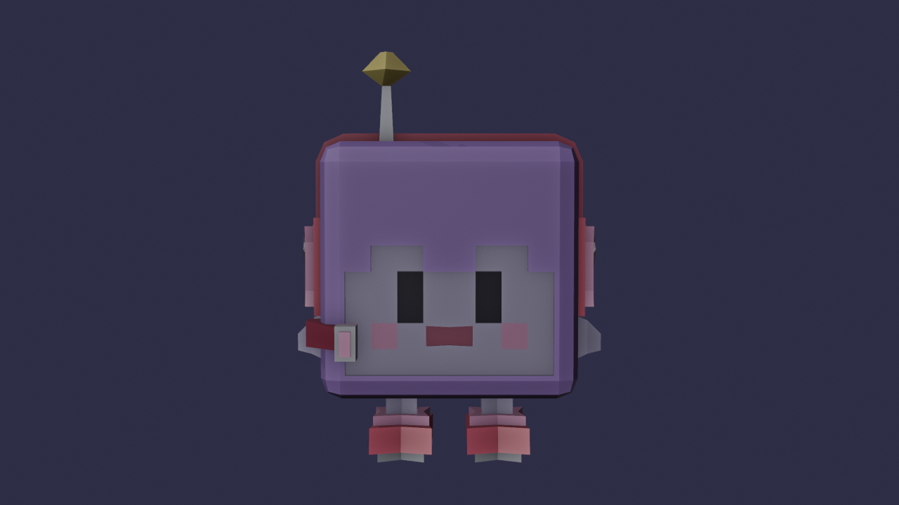
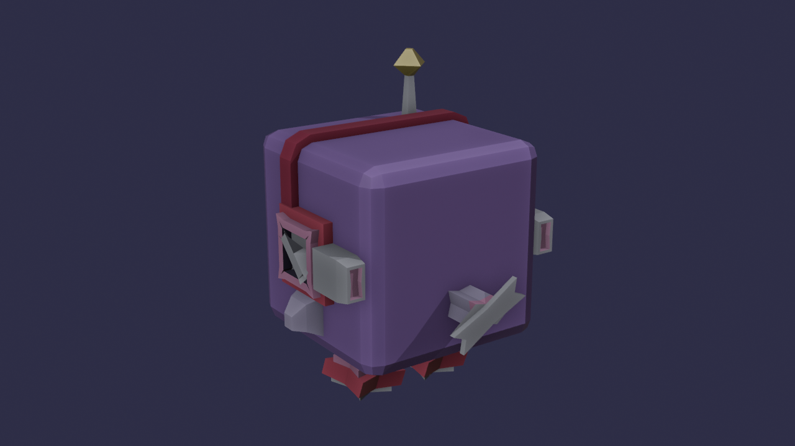

# Lab 3: Nave Lila en Blender

La Nave Lila: una idol alienígena cuya cabeza gigante es la nave, con audífonos que son turbinas, botas cohete y una hélice en la colita. Está modelada en Blender a partir del cubo por defecto, sin agregar ningún otro objeto, para cargarla después en el rasterizador por software.

## Cómo se hizo

Todo sale del cubo inicial, en una sola malla, usando solo las herramientas permitidas:

| Parte | Herramientas |
| --- | --- |
| Cabeza | subdivide del cubo (cuadrícula de 10×10 por cara) y bevel en las 12 aristas para redondearla |
| Cara | extrude hacia adentro para hundirla en el marco del pelo, con los flecos, los ojos y la boca (inset) |
| Diadema | extrude de una franja de caras sobre la cabeza |
| Audífonos | extrude (disco), inset y extrude (aro), inset y extrude hacia adentro (turbina), y una aspa con scale y rotate |
| Toberas | extrude a los lados, extrude hacia atrás e inset para la luz |
| Aletas | dos extrudes con scale que las van afinando |
| Micrófono | extrude del costado, extrude en diagonal hacia el frente (brazo), scale e inset para la punta |
| Antena | inset, extrude hacia arriba con scale y una estrella con extrude, scale y rotate |
| Piernas y botas | inset, extrude hacia abajo, y extrude con scale para el aro y la bota |
| Colita | inset, extrude hacia atrás y una hélice con scale y rotate |
| Orientación | rotate de toda la malla para que quede con Y arriba y mirando a -Z |

Materiales con solo color base: `pelo_violeta`, `piel_lila`, `ojo`, `boca`, `rosa`, `rojo`, `rojo_oscuro`, `metal`, `oscuro`, `estrella` y `tobera_luz`.

## Archivos

| Archivo | Contenido |
| --- | --- |
| `nave_lila.obj` | la nave exportada y triangulada (1 objeto, 3236 triángulos) |
| `nave_lila.mtl` | los colores de los materiales |
| `nave_lila.blend` | el archivo de Blender |
| `nave_lila*.png` | screenshots |
