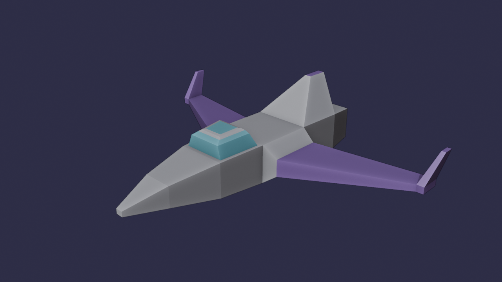
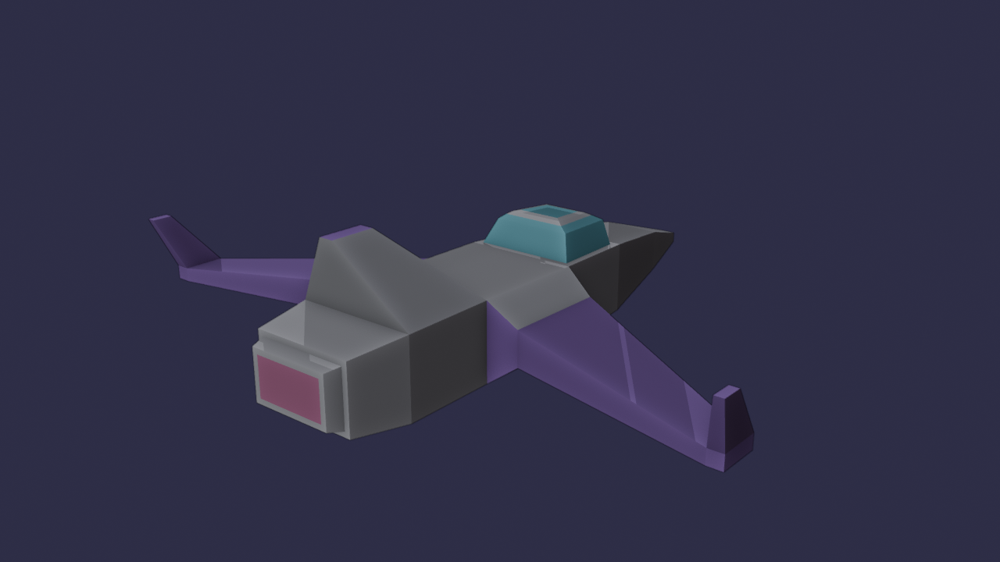

# Lab 3: nave espacial en Blender

Nave espacial modelada en Blender a partir del cubo por defecto, sin agregar ningún otro objeto, para cargarla después en el rasterizador por software.

## Cómo se hizo

Todo sale del cubo inicial, usando solo las herramientas permitidas:

| Parte | Herramientas |
| --- | --- |
| Fuselaje | scale del cubo |
| Nariz | tres extrudes hacia adelante, cada uno con scale para afilarla |
| Alas | extrude de los costados (raíz y ala en flecha) y otro extrude para las aletas de las puntas |
| Cabina | inset del techo, dos extrudes hacia arriba con scale y bevel en el borde |
| Aleta dorsal | extrude del techo de atrás y scale para dejarla delgada |
| Tobera | inset, extrude hacia afuera, inset y extrude hacia adentro |

Materiales con solo color base: `casco`, `alas`, `cabina` y `tobera`.

## Archivos

| Archivo | Contenido |
| --- | --- |
| `nave.obj` | la nave exportada y triangulada (1 objeto, 232 triángulos) |
| `nave.mtl` | los colores de los materiales |
| `nave.blend` | el archivo de Blender |
| `nave.png`, `nave_atras.png` | screenshots |
